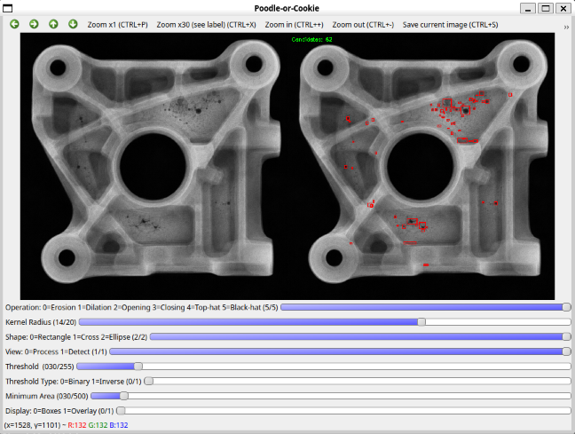
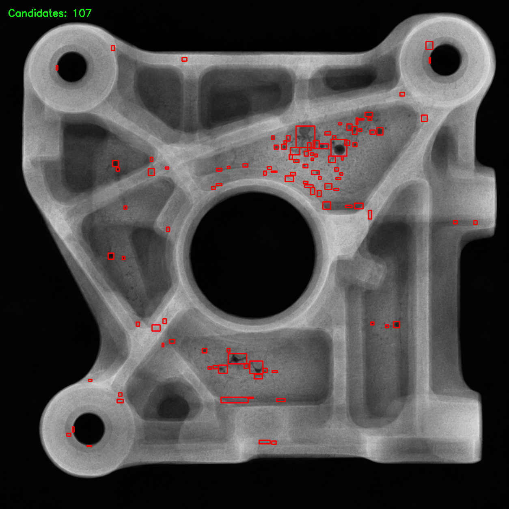
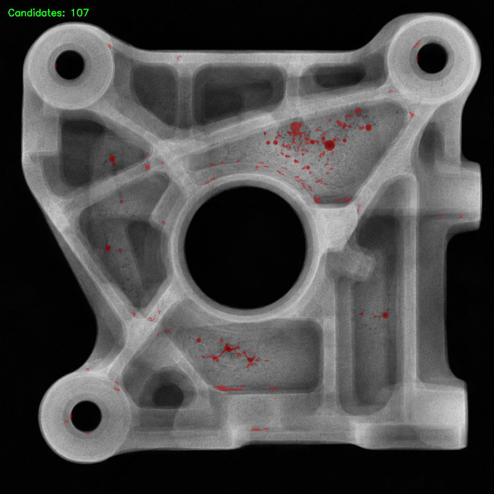
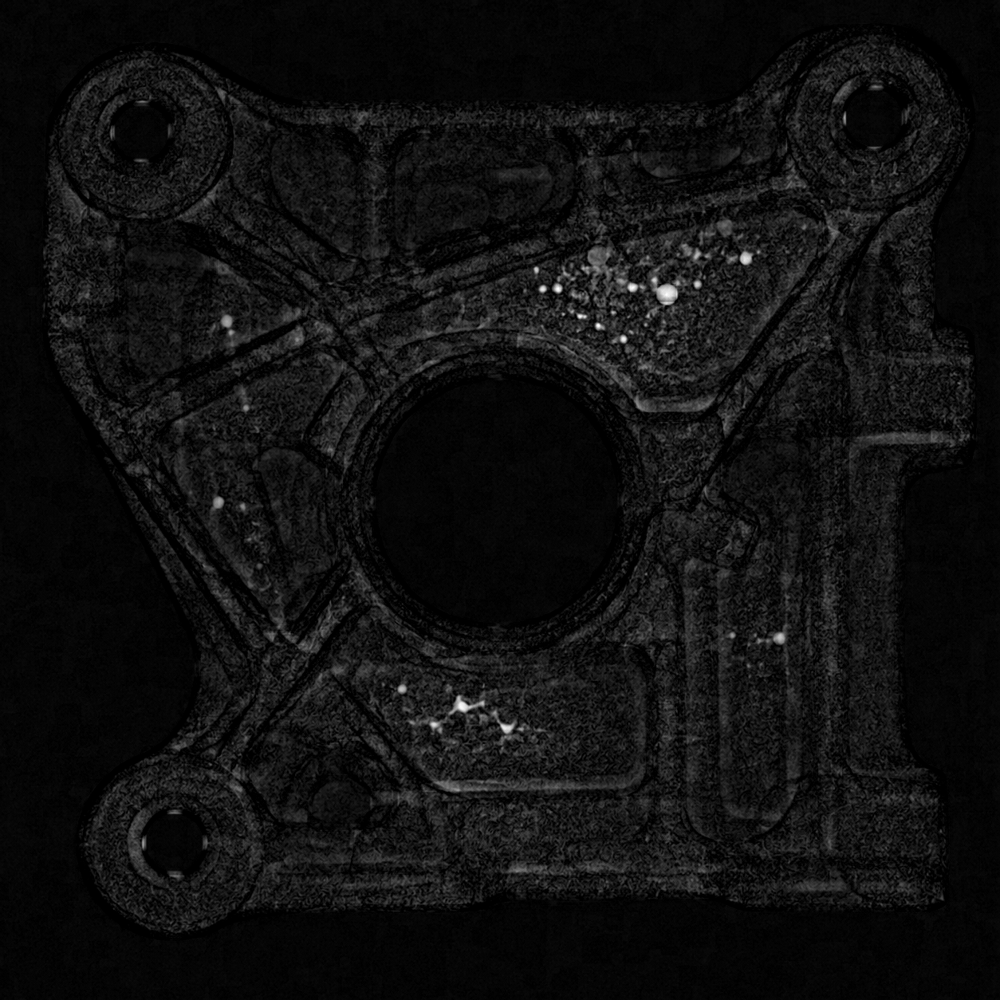

# Poodle-or-Cookie (Not a chocolate chip cookie!)
A small C++ project for experimenting with morphological image processing and defect detection using OpenCV.

I started this project to get more hands-on experience with C++ and image processing. The idea was to build a simple tool where I could try different morphological operations on X-ray-like images and see how they affect the detection of small, dark regions.

The name comes from the classic "poodle or chocolate chip cookie" memes, sometimes it is surprisingly hard to tell things apart.^^

## Demo

The program uses OpenCV's HighGUI trackbars to adjust the processing parameters without recompiling.



The detection results can be displayed as bounding boxes or as an overlay on the original image.

| Bounding boxes | Overlay |
|---|---|
|  |  |

For example, this is the result of applying a black-hat transformation:



The sample images are AI-generated X-ray-style images, not real industrial X-rays.

## What it does

The program supports six morphological operations: erosion, dilation, opening, closing, top-hat, and black-hat. The kernel size and shape (rectangle, cross, or ellipse) can be adjusted using trackbars.

For candidate detection, it applies a binary threshold to the processed image, finds connected components, and filters out regions smaller than a configurable minimum area.

The remaining regions are highlighted with red bounding boxes or a semi-transparent overlay. The number shown on screen is the number of candidate regions, not necessarily actual defects.

The processing functions are kept separate from the GUI code in `image_processing.cpp`, so they can also be tested independently.

## Build and run

The project uses C++17, OpenCV 4, and CMake. I developed it on Ubuntu 24.04 (WSL2).

On Ubuntu, install the dependencies:

```bash
sudo apt install build-essential cmake libopencv-dev
```

Build the project:

```bash
cmake -S . -B build
cmake --build build
```

Run it with one of the sample images:

```bash
./build/defect_detector data/synthetic/casting_02.png
```

A graphical desktop environment is required for the HighGUI windows.

## Tests

There are a few simple tests for connected-component filtering, using synthetic rectangles with known pixel areas.

They cover normal area filtering, the exact minimum-area boundary, and the case where all components are filtered out.

Run them with:

```bash
ctest --test-dir build --output-on-failure
```

## Notes

This is an experimental tool, not a reliable defect detector. The results depend quite a bit on the selected morphology and threshold parameters, and structural edges can easily be picked up as candidates.

I might add a Qt interface later, but for now I wanted to keep the project small and focus on the image processing itself.